# ambientCG: Ground materials

**23 assets from [ambientCG](https://ambientcg.com), dedicated to the public domain under [CC0](https://docs.ambientcg.com/license/).** Use them in any game, free or paid, and change them however you like; no credit is needed.

PBR materials as 1K and 2K JPG maps (colour, normal GL and DX, roughness, AO, displacement), one folder per resolution. 875.5 MB in all.

This is a copy kept by [zuujis-cc0](https://github.com/zuujis-cc0) so game makers can take single files from GitHub. It is not made by or affiliated with ambientCG: the originals, often in more formats and higher resolutions, are on [ambientcg.com](https://ambientcg.com). If they help you, consider [supporting ambientCG](https://www.patreon.com/ambientCG).

Every file is listed in [MANIFEST.tsv](MANIFEST.tsv) with its size and SHA-256. More free assets: [the Zuujis collection](https://github.com/zuujis-cc0/free-game-assets#readme).

| | | | |
| :-: | :-: | :-: | :-: |
| <a href="Ground044">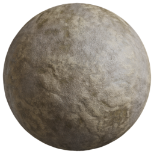</a> <b><a href="Ground044">Ground 044</a></b> by ambientCG · <a href="https://ambientcg.com/a/Ground044">source</a> | <a href="Ground045">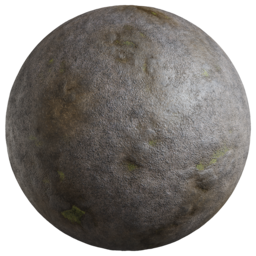</a> <b><a href="Ground045">Ground 045</a></b> by ambientCG · <a href="https://ambientcg.com/a/Ground045">source</a> | <a href="Ground046">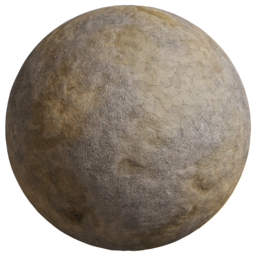</a> <b><a href="Ground046">Ground 046</a></b> by ambientCG · <a href="https://ambientcg.com/a/Ground046">source</a> | <a href="Ground047">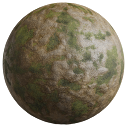</a> <b><a href="Ground047">Ground 047</a></b> by ambientCG · <a href="https://ambientcg.com/a/Ground047">source</a> |
| <a href="Ground048">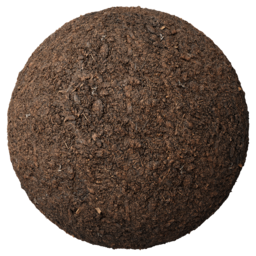</a> <b><a href="Ground048">Ground 048</a></b> by ambientCG · <a href="https://ambientcg.com/a/Ground048">source</a> | <a href="Ground049A">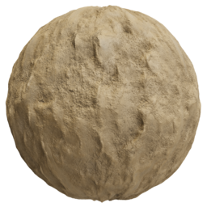</a> <b><a href="Ground049A">Ground 049 A</a></b> by ambientCG · <a href="https://ambientcg.com/a/Ground049A">source</a> | <a href="Ground049B">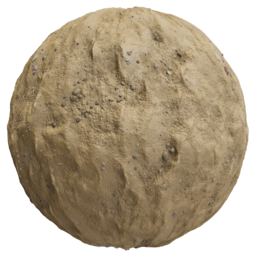</a> <b><a href="Ground049B">Ground 049 B</a></b> by ambientCG · <a href="https://ambientcg.com/a/Ground049B">source</a> | <a href="Ground049C">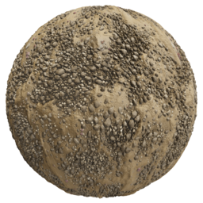</a> <b><a href="Ground049C">Ground 049 C</a></b> by ambientCG · <a href="https://ambientcg.com/a/Ground049C">source</a> |
| <a href="Ground050">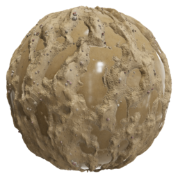</a> <b><a href="Ground050">Ground 050</a></b> by ambientCG · <a href="https://ambientcg.com/a/Ground050">source</a> | <a href="Ground051">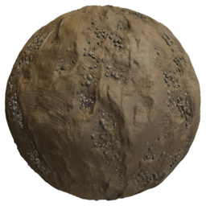</a> <b><a href="Ground051">Ground 051</a></b> by ambientCG · <a href="https://ambientcg.com/a/Ground051">source</a> | <a href="Ground052">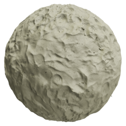</a> <b><a href="Ground052">Ground 052</a></b> by ambientCG · <a href="https://ambientcg.com/a/Ground052">source</a> | <a href="Ground053">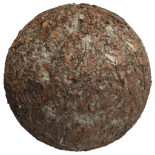</a> <b><a href="Ground053">Ground 053</a></b> by ambientCG · <a href="https://ambientcg.com/a/Ground053">source</a> |
| <a href="Ground054">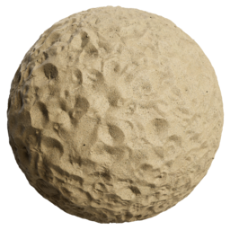</a> <b><a href="Ground054">Ground 054</a></b> by ambientCG · <a href="https://ambientcg.com/a/Ground054">source</a> | <a href="Ground055L">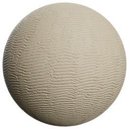</a> <b><a href="Ground055L">Ground 055 L</a></b> by ambientCG · <a href="https://ambientcg.com/a/Ground055L">source</a> | <a href="Ground055S">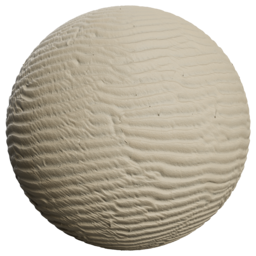</a> <b><a href="Ground055S">Ground 055 S</a></b> by ambientCG · <a href="https://ambientcg.com/a/Ground055S">source</a> | <a href="Ground056">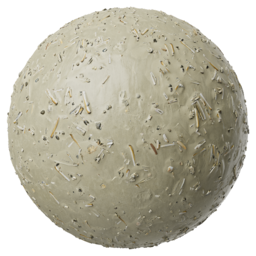</a> <b><a href="Ground056">Ground 056</a></b> by ambientCG · <a href="https://ambientcg.com/a/Ground056">source</a> |
| <a href="Ground057">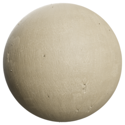</a> <b><a href="Ground057">Ground 057</a></b> by ambientCG · <a href="https://ambientcg.com/a/Ground057">source</a> | <a href="Ground058">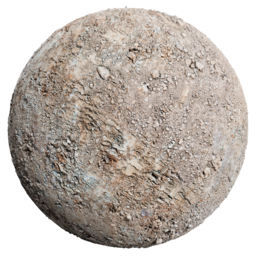</a> <b><a href="Ground058">Ground 058</a></b> by ambientCG · <a href="https://ambientcg.com/a/Ground058">source</a> | <a href="Ground059">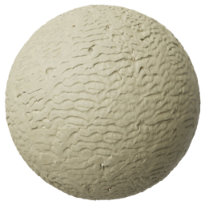</a> <b><a href="Ground059">Ground 059</a></b> by ambientCG · <a href="https://ambientcg.com/a/Ground059">source</a> | <a href="Ground060">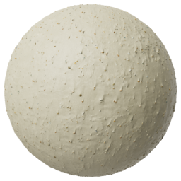</a> <b><a href="Ground060">Ground 060</a></b> by ambientCG · <a href="https://ambientcg.com/a/Ground060">source</a> |
| <a href="Ground061">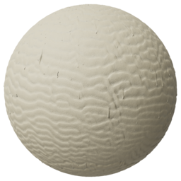</a> <b><a href="Ground061">Ground 061</a></b> by ambientCG · <a href="https://ambientcg.com/a/Ground061">source</a> | <a href="Ground062L">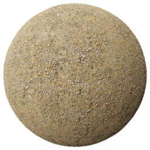</a> <b><a href="Ground062L">Ground 062 L</a></b> by ambientCG · <a href="https://ambientcg.com/a/Ground062L">source</a> | <a href="Ground062S">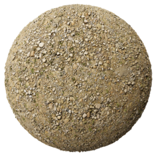</a> <b><a href="Ground062S">Ground 062 S</a></b> by ambientCG · <a href="https://ambientcg.com/a/Ground062S">source</a> |  |

---

Kept up to date by this repository's own [update workflow](.github/workflows/update.yml), with code and plan from [cc0-mirror](https://github.com/zuujis-cc0/cc0-mirror). Something wrong? [Open an issue there](https://github.com/zuujis-cc0/cc0-mirror/issues/new) or use the [private report form](https://games.zuujis.com/report).
